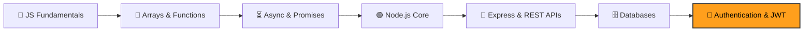

<div align="center">

# 🟨 JS Core

### My hands-on journey from JavaScript basics to backend development


*Every file here was written by hand, one concept at a time, to understand how things actually work under the hood.*

</div>

---

## 📖 About this repository

This is my **personal learning workspace**. I'm learning JavaScript the slow way on purpose: building small drills, breaking them, fixing them, and writing down what I learn along the way. No shortcuts, no copy-paste code, just practice.

> 🎯 **Goal:** become a confident backend developer who understands *why* code behaves the way it does, not just *that* it works.

---

## 🗺️ Learning roadmap



| Phase | Topic | Status |
|:--:|---|:--:|
| 1 | Primitives vs references, immutability, closures | ✅ Done |
| 2 | Array methods (`map`, `filter`, `reduce`) and real API practice | ✅ Done |
| 3 | Async JavaScript, promises, `async` / `await` | ✅ Done |
| 4 | Node.js core: event loop, file system, streams, `readline` | ✅ Done |
| 5 | Express: routes, `GET` / `POST`, JSON body parsing, error handling | ✅ Done |
| 6 | Databases and connecting them to the backend | 🔄 In progress |
| 7 | **Authentication, sessions, and JWT tokens** | 🌱 **Just started** |

---

## 🧠 What I've covered so far

### 🟦 Phase 1: JavaScript fundamentals
- How **primitive** values are copied and how **reference** types get shared
- **Shallow vs deep copy** using the spread operator and `structuredClone`
- **Immutability** and why changing state directly causes bugs
- **Closures**: functions that remember their surrounding variables

### 🟩 Phase 2: Working with data
- Filtering, mapping, and reducing arrays of objects
- Calling a **real public API** with `fetch` and reshaping its response

### 🟨 Phase 3: Asynchronous code
- Promises, `async` / `await`, and `try` / `catch` for failures
- Understanding that async code doesn't block the rest of the program

### 🟥 Phase 4: Node.js internals
- The **event loop** and the order in which callbacks run
- Reading and writing files with `fs` (callbacks and promises)
- Processing large files line by line with **streams** and `readline`
- Reading logs and extracting useful information from them

### 🟪 Phase 5: Express and HTTP
- Building an Express server with `GET`, `POST` and a fallback 404 route
- Parsing JSON request bodies with `express.json()`
- Validating input and returning proper status codes (`200`, `400`, `404`, `500`)
- Persisting data to a JSON file so it survives server restarts

### 🗄️ Phase 6: Databases (in progress)
- Connecting a database to the backend and running queries from Node

---

## 🔐 Currently learning: Authentication & JWT

I've just started this stage. The plan is to learn:

- [ ] What authentication is and how it differs from authorization
- [ ] Password hashing (why plain-text passwords are never acceptable)
- [ ] How JSON Web Tokens (JWT) are built: header, payload, signature
- [ ] Protecting routes with middleware
- [ ] Refresh tokens and safe token storage

---

## 📂 Repository structure

```
js-core/
├── 01-primitives-vs-references.js   # Copying values vs sharing references
├── 02-array-filtering-loops.js      # Loops and filtering
├── 03-immutability-state.js         # Keeping state predictable
├── 04-async-promises.js             # Promises and async/await
├── 05-array-method-*.js             # map, filter, reduce drills
├── 06-real-api-practice.js          # Fetching and reshaping real API data
├── 07-closures.js                   # Closures and private state
│
├── node-phase-02/                   # Node.js core modules
│   ├── 01-event-loop.js             # Execution order explained by practice
│   ├── 02-file-processor.js         # Reading files
│   ├── steam.js                     # Streaming a file line by line
│   └── addplayerdrill.js            # Writing data to a JSON file
│
├── express-players/                 # Express REST API practice
│   ├── getplayerinexpress.js        # GET routes and error handling
│   ├── post-addplayertask.js        # POST routes and input validation
│   └── package.json                 # Dependencies (express)
│
└── test-phase-01.js                 # Standalone practice file
```

---

## ▶️ How to run the examples

**Plain JavaScript files** (requires [Node.js](https://nodejs.org)):

```bash
node 01-primitives-vs-references.js
```

**Express practice** (install dependencies first):

```bash
cd express-players
npm install
node post-addplayertask.js
```

---

## 💡 What I'm taking away

> *"Code you can explain is code you actually understand."*

Every drill here is a small question I asked myself and answered by running the code. The mistakes are kept on purpose, because they're the most useful part of learning.

---

<div align="center">

**⭐ Learning in public, one commit at a time.**

</div>
