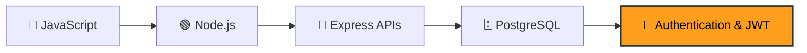

<div align="center">

# 🚀 Engine: My Full-Stack Learning Journey

### From JavaScript basics to backend, databases, and authentication


*Everything here is written by hand, one concept at a time, to understand how things really work.*

</div>

---

## 📖 About

This repository is my **personal learning workspace**. I practice each topic with small drills, break things, fix them, and move on to the next stage. The goal is to become a backend developer who understands *why* code behaves the way it does.

## 🗺️ Learning roadmap



| Stage | Folder | What I practiced | Status |
|:--:|---|---|:--:|
| 1 | [`js-core/`](./js-core) | JS fundamentals, closures, async/await, array methods, Node core (event loop, `fs`, streams), Express GET/POST | ✅ Done |
| 2 | [`pg-practice/`](./pg-practice) | Connecting Node to PostgreSQL with `pg`, running `SELECT`, `UPDATE`, `DELETE` queries, using `.env` for config | ✅ Done |
| 3 | [`player-pg/`](./player-pg) | A REST API (Express + PostgreSQL) with `GET`, `POST`, `PUT` routes, input validation and proper status codes | ✅ Done |
| 4 | [`auth-practice/`](./auth-practice) | **Authentication**: password hashing with `bcryptjs`, then JWT tokens | 🌱 **Just started** |

## 🔐 Currently learning: Authentication & JWT

- [x] Setting up the project and password hashing library (`bcryptjs`)
- [ ] Registering users and storing hashed passwords
- [ ] Logging in and issuing JSON Web Tokens
- [ ] Protecting routes with middleware
- [ ] Refresh tokens and safe token storage

## 📂 Repository structure

```
engine/
├── js-core/         # JavaScript + Node + Express fundamentals (has its own README)
├── pg-practice/     # PostgreSQL queries from Node
├── player-pg/       # Express + PostgreSQL REST API
└── auth-practice/   # Authentication and JWT (just started)
```

## ▶️ Running the projects

Each folder is its own small project. Install its dependencies first, then run a file:

```bash
cd player-pg
npm install
node app.js
```

The database projects read the password from a local `.env` file (not committed):

```
DB_PASSWORD=your_password_here
```

---

<div align="center">

**⭐ Learning in public, one commit at a time.**

</div>
